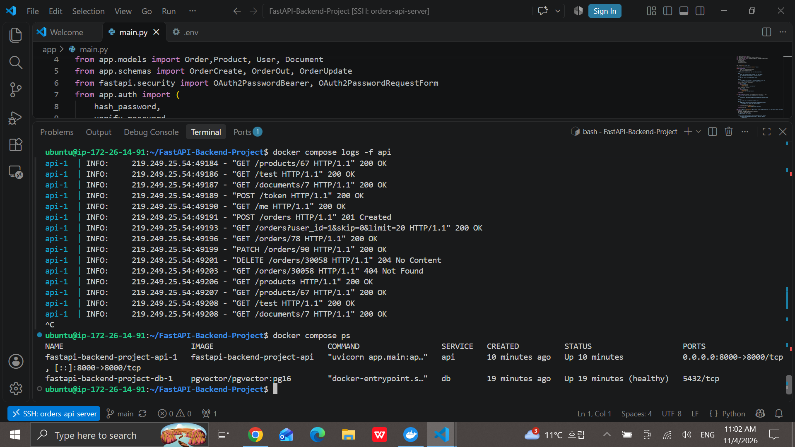
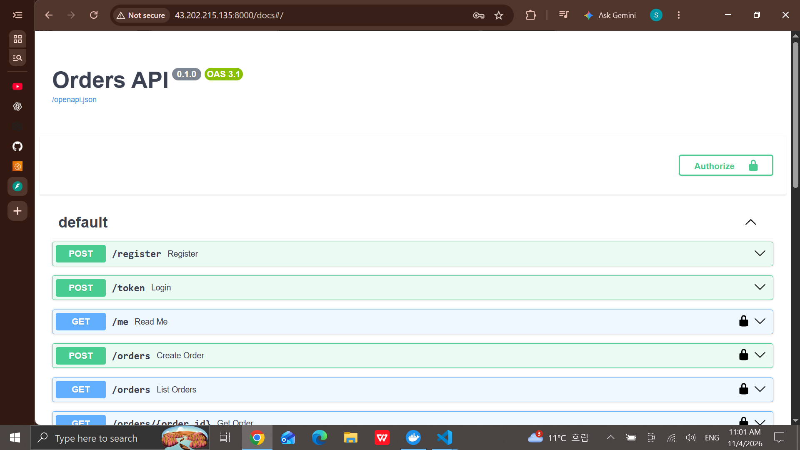

# Deployment Documentation

## 1. Deployment Platform

The FastAPI application is deployed on an AWS Lightsail Ubuntu instance using Docker Compose.

**Technologies used:**
- AWS Lightsail
- Ubuntu
- Docker
- Docker Compose
- FastAPI
- PostgreSQL with pgvector

## 2. Live Application

**Public API URL:**

http://43.202.215.135:8000/test

**Swagger UI:**

http://43.202.215.135:8000/docs


## 3. Deployment Steps

The application was deployed using the following steps:

1. Created an Ubuntu instance on AWS Lightsail.
2. Configured SSH access using an SSH key pair.
3. Connected to the remote server through VS Code Remote - SSH.
4. Cloned the project repository from GitHub.
5. Configured the required environment variables on the server.
6. Built and started the API and PostgreSQL services using Docker Compose.
7. Verified the deployment through the public API URL.

**Docker Compose command:**

```bash
docker compose up -d --build
```

## 4. Running Containers

The following command was used to verify the deployed services:

```bash
docker compose ps
```

**Server output:**



## 5. Live Swagger UI

The Swagger UI is accessible through the deployed server:

http://43.202.215.135:8000/docs



## 6. Redeployment and Database Persistence

A new API endpoint was implemented to retrieve documents, accessible only to authenticated users.

The updated application code was committed and pushed to GitHub, then pulled onto the AWS Lightsail server.

The Docker Compose services were rebuilt and restarted to apply the changes.

The updated API endpoint was tested through the deployed application, and the existing database tables and records were preserved after redeployment.

## 7. Deployment Status

- API service: Running
- PostgreSQL service: Running
- Database health: Healthy
- Swagger UI: Accessible
- Redeployment: Verified
- Database persistence: Verified