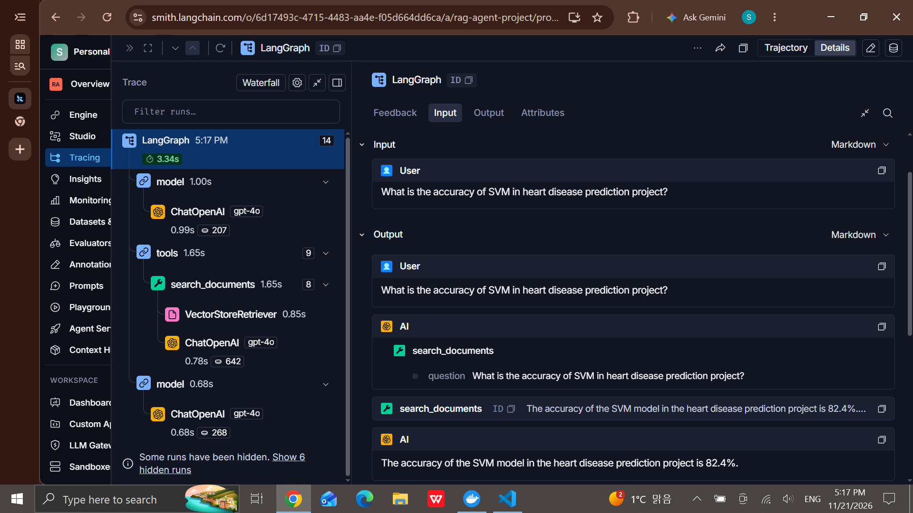

# RAG Chatbot Over a Custom Document Corpus

## Project Overview

This project implements a Retrieval-Augmented Generation (RAG) chatbot that answers questions using a custom knowledge base containing two project study guides. It combines semantic search, vector storage, LLM-based generation, agentic tool calling, and response streaming.

The primary objective is to generate context-aware answers grounded in the uploaded documents rather than relying entirely on the LLM's general knowledge.

The application also integrates a product-price lookup tool, allowing the AI agent to handle both document-based questions and product-related queries.

## 1. Knowledge Base (Document Corpus)

The knowledge base consists of two custom study guide documents created from my previous projects.

### ForensicUI Project — Computer Vision

This document contains:
- Project architecture and implementation details.
- Computer vision models and techniques used in the project.
- Fundamental computer vision concepts in a Q&A format.
- Topics such as embeddings, cosine similarity, and ByteTrack.

### Heart Disease Prediction — Machine Learning

This document contains:
- Project implementation details.
- Information about seven machine learning models used in the project.
- Fundamental machine learning concepts in a Q&A format.
- Topics such as Support Vector Machines (SVM), Decision Trees, and Logistic Regression.

The chatbot retrieves relevant information from these documents and uses it as context for answer generation. Where applicable, external website sources are also included to support answer verification.

## 2. Document Ingestion and Embedding

The document ingestion pipeline converts the source documents into vector representations that can be searched based on semantic similarity.

### Processing steps

1. **Document loading:** Loads the two custom study guide documents.
2. **Text chunking:** Uses `RecursiveCharacterTextSplitter` to divide documents into smaller, manageable chunks.
3. **Chunk configuration:**
   - Chunk size: 500 characters
   - Chunk overlap: 50 characters
4. **Embedding generation:** Uses OpenAI's `text-embedding-3-small` model to convert each text chunk into a numerical vector.
5. **Vector storage:** Stores the embeddings and associated metadata in PostgreSQL using the PGVector extension.
6. **Vector indexing:** Creates an HNSW index using cosine distance to improve similarity search performance.

A total of **353 embeddings** were generated and stored in the PostgreSQL database.

### Vector indexing

An HNSW (Hierarchical Navigable Small World) index was created on the embedding column using cosine distance.

The cosine distance operator (`<=>`) is used to identify semantically similar vectors.

This indexing approach improves the efficiency of nearest-neighbor vector searches as the knowledge base grows.

## 3. Retrieval and Generation

The project initially implemented a manual RAG pipeline to understand and validate the retrieval and generation process.

### Manual RAG implementation

**Retrieval:**
- Converts the user's question into an embedding using `text-embedding-3-small`.
- Compares the question embedding against stored document embeddings using cosine distance (`<=>`).
- Retrieves the top 4 most relevant chunks (`k=4`).

**Generation:**
- Passes the retrieved document chunks and the user's question to GPT-4o.
- Uses the retrieved context to generate a grounded answer.
- Streams the generated response instead of waiting for the entire answer to finish.

The manual implementation was tested against the PostgreSQL vector database to validate the retrieval and generation workflow.

## 4. LangChain Pipeline and Observability

After implementing and validating manual RAG, a LangChain-based pipeline was developed using the same PostgreSQL vector database.

The purpose was to organize the retrieval and generation components into a reusable pipeline and integrate tracing for better observability.

LangChain components were used to manage:
- Document retrieval.
- Prompt construction.
- LLM invocation.
- Retrieval and generation workflows.

Langsmith demo image from end to end tracing

### LangSmith Integration

LangSmith was integrated to trace the application's execution flow.

It provides visibility into:
- User queries.
- Retrieved documents.
- LLM interactions.
- Tool execution.
- End-to-end execution traces.

This makes it easier to inspect the system's behavior, identify failures, and evaluate the RAG workflow.

### LangSmith – End-to-End Tracing Demo

The following screenshot demonstrates end-to-end tracing in LangSmith, showing the execution flow of the RAG application.

## 5. Agentic AI and Tool Calling

To extend the chatbot beyond document retrieval, I integrated an AI agent using LangChain's `create_agent()`.

The agent has access to two tools:

### Tool 1: Document Search

- Retrieves relevant chunks from the custom knowledge base.
- Uses the existing PGVector retriever.
- Generates answers using the retrieved context.

### Tool 2: Product Price Lookup

- Retrieves product prices from the PostgreSQL products table.
- Handles product-related price queries using database information.

### Agent workflow

The agent receives the user's query and determines which tool is appropriate based on the query's intent.

For example:
- A question about ByteTrack triggers the document-search tool.
- A question about a product's price triggers the product-price lookup tool.

The agent then uses the tool's output to formulate its response.

## 6. Response Caching

An in-memory Python dictionary was implemented to cache previously generated responses.

The cache uses a SHA-256 hash of the user's question as the cache key.

### Workflow

1. Receive the user's question.
2. Generate a SHA-256 hash of the question.
3. Check whether the hash exists in the cache.
4. If a cached response exists, return it without executing the agent again.
5. Otherwise, execute the agent, generate the response, and store the result in the cache.

This reduces repeated LLM calls for identical questions, helping reduce processing time, latency, and API costs.

The cache is maintained in memory for the current application process and is not persistent across application restarts.

## 7. FastAPI Backend and Streaming

FastAPI provides the backend API for receiving user queries and returning generated responses.

An endpoint was implemented:

`POST /ask`

A Pydantic model validates the incoming request data before processing.

The endpoint:
- Receives the user's question.
- Passes the query to the agent.
- Streams the generated response.
- Sends answer tokens and source metadata to the client.

Server-Sent Events (SSE) are used to stream the response from the backend to the frontend.

## 8. Streamlit User Interface

A lightweight Streamlit interface was developed to interact with the RAG application.

The UI is responsible for:
- Accepting user questions.
- Sending requests to the FastAPI backend.
- Receiving streamed responses through SSE.
- Displaying the generated answer incrementally.
- Displaying source document information alongside the answer.

This provides an interactive experience without requiring users to interact directly with the API.

## 9. Testing and Evaluation

The application was tested using LangSmith to inspect the execution flow and evaluate the quality of generated responses.

### Evaluation dataset

A custom evaluation dataset containing 25 questions was created.

The dataset included:
- Questions related to the ForensicUI project.
- Questions related to the Heart Disease Prediction project.
- Product-price questions.
- Questions containing information not available in the knowledge base.

### Evaluation approach

The system was evaluated using:
- **LLM-as-a-Judge:** Uses an LLM to assess the quality of generated responses against evaluation criteria.
- **Correctness:** Evaluates whether the generated answer correctly addresses the expected answer.

## Live Demo – Deployed RAG Application

The following video demonstrates the end-to-end RAG pipeline running on a remote AWS Lightsail server, showcasing the application's functionality and workflow.

**Public Application URL:** 

http://43.202.215.135:8501/ask

[Watch RAG Pipeline Demo](rag_assets/rag-demo.mp4)

## 10. Technology Stack

| Component | Technologies |
|---|---|
| Programming Language | Python |
| LLM | OpenAI GPT-4o |
| Embedding Model | OpenAI text-embedding-3-small |
| RAG Framework | LangChain |
| Agent Framework | LangChain `create_agent()` |
| Vector Database | PostgreSQL + PGVector |
| Vector Indexing | HNSW |
| Backend | FastAPI |
| Data Validation | Pydantic |
| Frontend | Streamlit |
| Streaming | Server-Sent Events (SSE) |
| Observability | LangSmith |
| Containerization | Docker, Docker Compose |
| Deployment | AWS Lightsail |

## Key Features

- Custom document-based question answering.
- Semantic retrieval using vector embeddings.
- PostgreSQL and PGVector integration.
- HNSW indexing for efficient vector similarity search.
- Manual RAG implementation and LangChain-based pipeline.
- Agentic tool calling for document search and product-price lookup.
- Streaming responses using FastAPI and SSE.
- In-memory response caching.
- End-to-end tracing with LangSmith.
- Evaluation using a custom dataset and LLM-as-a-Judge.
- Docker-based deployment.

